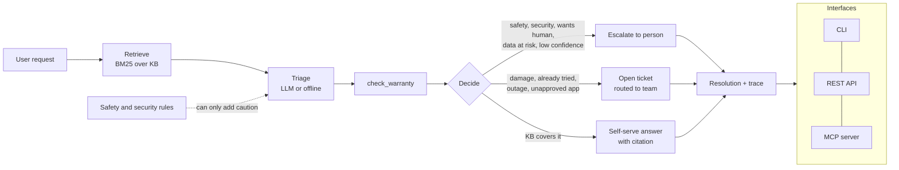

# FixFlow: AI agent for IT-support triage

[](https://github.com/YOUR_GITHUB_USERNAME/fixflow/actions/workflows/ci.yml)


FixFlow reads a support request written in plain language, such as *"my laptop is plugged in but stuck at 80%"*, and decides what should happen next:

- **Self-serve:** answer with steps from the right troubleshooting article, with a citation.
- **Ticket:** open a ticket and route it to the right team (hardware repair, network ops, software support or IT helpdesk).
- **Escalate:** hand it to a person when it is a safety or security risk, the user asks for a human, data is at risk, or the agent is not confident.

It also checks the device's warranty and explains every decision in a step-by-step trace.

**Live demo: [fixflow-nehm.onrender.com](https://fixflow-nehm.onrender.com)**: type a problem and watch the agent's pipeline run step by step, then click any report on the live issue board to see why the AI decided what it did. (Free hosting: the first visit can take up to 50 seconds to wake up.)

**Measured on a held-out test set of 30 labeled tickets:** 100% correct action, 90% correct category, and every safety case escalated (2 of 2). [Full results](#evaluation).

```text
$ python -m fixflow "The bottom of my laptop is bulging" --serial PF7Q2M88 --trace
Action:     escalate
Category:   safety_hazard  ->  team: safety_response
Urgency:    critical   confidence: 1.00
Why:        Possible safety hazard: always handled by a person.
Ticket:     FF-60B9B46C

I've passed this to a support specialist (ticket FF-60B9B46C). Someone will contact you directly.
1. Stop using the device. Unplug the charger if it is safe to do so.
2. Do not charge it, press on it, or try to remove the battery yourself.
...
Note: your AeroBook 14 Gen 3 warranty ended on 2026-01-20, so repairs are paid.

Trace:
  - retrieve: KB-005 (5.25), KB-003 (4.35), KB-007 (1.28)
  - triage[offline]: category=safety_hazard urgency=critical confidence=1.00
  - check_warranty: {'serial': 'PF7Q2M88', 'model': 'AeroBook 14 Gen 3', 'plan': 'base', ...}
  - decide: escalate -> safety_response (Possible safety hazard: always handled by a person.)
  - act: ticket FF-60B9B46C
```

## What's inside

| Piece | What it does | Where |
|---|---|---|
| **Retrieval from scratch** | Tokenizer, BM25 ranking and an inverted index, written by hand with no vector database | `fixflow/retrieval.py` |
| **Guarded LLM triage** | Claude or OpenAI returns schema-validated JSON; safety rules can only make the result more careful | `fixflow/llm.py`, `fixflow/classify.py` |
| **Agent workflow** | retrieve → triage → check warranty → decide → act → explain, with a full trace | `fixflow/agent.py` |
| **Tools** | Warranty lookup, ticket creation, human escalation (SQLite), approved-software catalog | `fixflow/tools.py`, `fixflow/catalog.py` |
| **MCP server** | Exposes the tools to any MCP client, such as Claude Desktop | `fixflow/mcp_server.py` |
| **REST API** | FastAPI service: `/triage`, `/activity` (issue board), `/tickets`, docs at `/docs` | `fixflow/api.py` |
| **Demo web app** | Animated single-file front end: live agent pipeline, streaming trace, issue board fed from the database | `fixflow/static/index.html` |
| **Evaluation** | 50 labeled tickets split into dev and held-out test sets; CI fails if quality drops | `fixflow/evals.py`, `data/eval/` |
| **Production basics** | 41 tests, fake LLM clients, Docker image with health check, GitHub Actions CI | `tests/`, `Dockerfile`, `.github/` |

## Architecture



## Quick start

```bash
git clone https://github.com/YOUR_GITHUB_USERNAME/fixflow.git
cd fixflow
python -m venv .venv && source .venv/bin/activate   # Windows: .venv\Scripts\activate
pip install -r requirements-dev.txt

python -m fixflow "wifi keeps disconnecting every 10 minutes" --trace   # CLI
pytest -q                                                                # tests
python -m fixflow.evals --compare                                        # evaluation
uvicorn fixflow.api:app --reload                                         # API at http://localhost:8000/docs
```

Everything above runs **offline with no API key**. To use a real LLM, copy `.env.example` to `.env`, or export:

```bash
export FIXFLOW_PROVIDER=anthropic   # or openai
export ANTHROPIC_API_KEY=sk-...      # or OPENAI_API_KEY
python -m fixflow "my screen flickers when I scroll"
```

**Free option (Groq):** Groq offers a free plan with an OpenAI-compatible API. Create a key at console.groq.com, then:

```bash
export FIXFLOW_PROVIDER=openai
export OPENAI_BASE_URL=https://api.groq.com/openai/v1
export OPENAI_API_KEY=gsk_...                 # your Groq key
export FIXFLOW_MODEL=openai/gpt-oss-120b
```

If the free limit is hit or the API fails, FixFlow falls back to the offline triager automatically, and the trace says so.

With Docker:

```bash
docker build -t fixflow . && docker run --rm -p 8000:8000 fixflow
curl -X POST localhost:8000/triage -H 'content-type: application/json' \
     -d '{"text": "I spilled coffee on my keyboard", "serial": "PF3K9X21"}'
```

## Use it from Claude Desktop (MCP)

FixFlow runs as an MCP server with five tools: `triage_request`, `search_manuals`, `check_warranty`, `create_ticket` and `get_ticket`.

1. Install the project as shown in Quick start.
2. Open Claude Desktop → Settings → Developer → Edit Config, and add the block from [`examples/claude_desktop_config.json`](examples/claude_desktop_config.json) with your real paths.
3. Restart Claude Desktop and ask: *"Check the warranty for NV5T1R43 and open a ticket for its cracked screen."*

## Evaluation

The project includes 50 hand-labeled tickets (`data/eval/tickets.jsonl`) covering typos, vague requests, repeat reports, outages and safety cases. They are split into:

- **dev (20 tickets):** the only tickets used while building and tuning.
- **test (30 tickets):** held out and run once, after tuning was finished.

Results with the offline triager, comparing the baseline retriever (v1) with the improved one (v2: light stemming, a title field boost, and one synonym rule added after a dev failure):

| Metric | test, v1 | **test, v2** |
|---|---|---|
| Correct action (self-serve / ticket / escalate) | 96.7% | **100%** |
| Correct category | 86.7% | **90.0%** |
| Correct team | 86.7% | **93.3%** |
| Retrieval hit@1 / hit@3 | 73.3% / 86.7% | **76.7% / 86.7%** |
| Escalation precision / recall | 85.7% / 100% | **100% / 100%** |
| Safety cases escalated | 2/2 | **2/2** |
| Time per ticket | 0.2 ms | 0.3 ms |

Full output, including every miss, is in [`results/eval_offline.md`](results/eval_offline.md). Run `FIXFLOW_PROVIDER=anthropic python -m fixflow.evals --compare` to produce the same table for the LLM triager.

**Known misses on the test set:**

- "VPN says authentication failed" is filed as an account problem rather than a network one.
- "Office keeps saying unlicensed product" is not recognised as a software issue.
- "pc not working" gets an arbitrary category. Its action is still correct: it goes to a person, because confidence is low.

**Honest limits:** the knowledge base, devices and tickets are synthetic and were written for this project by the same person who built the system. 30 test tickets is small, so treat these numbers as a sanity check, not a benchmark.

## Design decisions

- **Workflow, not a free-roaming agent.** Following Anthropic's [Building effective agents](https://www.anthropic.com/engineering/building-effective-agents), the LLM handles language (classifying, writing answers) while routing is plain code. That makes every decision testable and explainable.
- **Guardrails outside the model.** Safety and security rules are OR-ed with the model's output. A model mistake can make FixFlow more cautious but never less, and safety cases are never auto-closed.
- **Structured outputs.** The model must return JSON matching the `Triage` schema (a forced tool call on Anthropic, JSON mode on OpenAI). Pydantic rejects anything invalid, and the agent falls back to the offline triager instead of failing.
- **Groundedness check on LLM answers.** Testing the live demo showed the model sometimes adds plausible steps that are not in the manual, despite the prompt. Every numbered step is now compared with the cited article (word-stem overlap); if any step is not supported, the LLM reply is discarded, the article's own steps are used, and the trace records it. It is a cheap heuristic: it catches clearly invented steps, not subtle ones.
- **BM25 instead of a vector database.** For about 40 short sections, BM25 is fast, transparent and needs no extra infrastructure. The `Retriever` interface makes it straightforward to add embeddings later.
- **Confidence threshold.** Below 0.35 confidence the agent escalates rather than guesses. The threshold is configurable with `FIXFLOW_CONFIDENCE_THRESHOLD`.
- **Evaluation in CI.** The build fails if test-set action accuracy drops below 90%, so a change that breaks quality cannot be merged unnoticed.

## Project layout

```text
fixflow/
  agent.py        decision workflow and answers
  retrieval.py    tokenizer, BM25, inverted index (v1 and v2)
  classify.py     offline triage and safety rules
  llm.py          Anthropic and OpenAI clients, guarded LLM triage
  tools.py        SQLite: warranty, tickets, escalation
  catalog.py      approved-software catalog
  evals.py        evaluation harness
  api.py          FastAPI app
  static/         demo web app (index.html)
  mcp_server.py   MCP server
data/
  kb/             12 troubleshooting articles (Markdown)
  devices.csv     device and warranty records
  software_catalog.csv
  eval/tickets.jsonl
tests/            pytest suite, with fake LLM clients
```

## Roadmap

- Hybrid retrieval (BM25 + embeddings) and a cross-encoder re-ranker
- LLM-as-judge scoring for answer quality, alongside the exact-match metrics
- Feedback loop: when a self-served user still opens a ticket, add that case to the eval set
- Small web front end in React

## License

MIT
